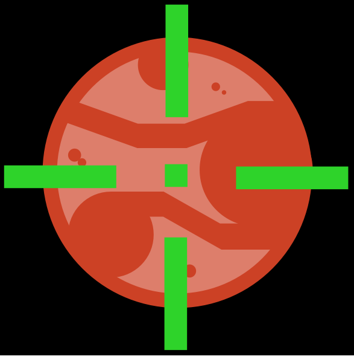

# AstroLocator



A small Python console application that displays the Moon's and planets' altitude
and azimuth for an observer on Earth. Designed to be the backend for a future celestial
object laser locator. **Skyfield performs the astronomical calculations**, using the bundled
JPL DE421 ephemeris. AstroLocator provides coordinate validation, target selection, and a simple
terminal interface.

## Features

- Moon, Mercury, Venus, Mars, Jupiter, Saturn, Uranus, and Neptune.
- Configurable latitude and longitude, supplied as arguments or prompted at startup.
- UTC timestamp and apparent altitude/azimuth for each calculation.
- Immediate recalculation after target selection. press Enter to refresh manually.

## Install and run

Use Python 3.10 or newer (tested with Python 3.11). From the repository directory:

```sh
python -m venv .venv
```

Activate the environment:

```powershell
# Windows PowerShell
.\.venv\Scripts\Activate.ps1
```

```sh
# macOS / Linux
source .venv/bin/activate
```

Then install the dependency and launch:

```sh
python -m pip install -r requirements.txt
python AstroLocator.py --latitude 51.4779 --longitude -0.0015
```

On Windows, `py` can replace `python` when creating the environment. Alternatively,
use the full path to your Python installation. Activation is optional if you use
`.venv\Scripts\python.exe` (Windows) or `.venv/bin/python` (macOS/Linux) directly.

Run `python AstroLocator.py` to enter coordinates at prompts. Latitude must be
between -90 and 90 degrees; longitude between -180 and 180, inclusive. North and
east are positive; south and west are negative. Non-numeric and non-finite values
are rejected. `python AstroLocator.py --help` lists arguments.

The default `de421.bsp` is located beside `coordinates.py`, even when launching the
script from another directory. You can override it with `--ephemeris PATH` (a
relative override is relative to your current directory). Missing, unreadable,
invalid, or incompatible kernels produce an error with recovery instructions.
Restore the repository's `de421.bsp` if needed. There are no automatic downloads
at runtime; Skyfield's bundled time tables are used.

## Controls

Type a command and press Enter:

| Command | Action |
| --- | --- |
| Enter with no text | Recalculate the selected target at the current time |
| Target name, such as `Mars` | Select and immediately calculate that target (case-insensitive) |
| `n` / `p` | Next / previous target, wrapping at either end |
| `q` or `quit` | Exit, also available at coordinate prompts |
| Ctrl+C or end-of-input | Exit gracefully |

Results remain visible as scrollback. They are timestamped snapshots, **not a
continuously updating display**. Invalid commands leave the selection unchanged.

Example session layout (fixed-time values shown; live results use your current time):

```text
AstroLocator | Latitude / Longitude: 51.4779, -0.0015 degrees
Targets: Moon, Mercury, Venus, Mars, Jupiter, Saturn, Uranus, Neptune
Enter: refresh | n/p: next/previous | target name: select | q: quit
2024-01-01 00:00:00 UTC | Moon | Altitude: 28.17 deg | Azimuth: 107.11 deg
> Mars
2024-01-01 00:00:00 UTC | Mars | Altitude: -60.70 deg | Azimuth: 25.03 deg
> q
```

Altitude is degrees above the horizon (negative means below it). Azimuth is
clockwise from true north: north 0°, east 90°, south 180°, west 270°.

## Tests

From the repository directory, with dependencies installed:

```sh
python -m unittest discover -s tests -v
python -m compileall -q AstroLocator.py coordinates.py tests
python -m pip check
```

The standard-library test suite checks coordinate boundaries and invalid input,
all target mappings, navigation and wraparound, recalculation before the next
prompt, refresh behavior, graceful exits, and ephemeris loading/errors. Calculation
tests use fixed UTC times and the bundled DE421 kernel, with physical-range,
location/time sensitivity, and numerical regression checks.

These are **numerical sanity and regression tests, not independent accuracy
verification**. Values generated using Skyfield and the same kernel cannot
independently validate Skyfield. No comparison against an external reference
such as JPL Horizons or measured observations has been performed. Console tests
use mocked input; they do not establish real interactive terminal behavior.

## Scope and limitations

- The observer is at sea level on the WGS84 ellipsoid. Elevation, terrain,
  atmospheric refraction, and local obstructions are not modeled.
- Outer planets use their system barycenters from DE421, not individual planet
  centers. The displayed two decimal places are formatting, not an accuracy claim.
- Dates must fall within the bundled kernel's coverage (approximately 1900–2053).
  The live interface uses the computer's clock; an out-of-range time reports an error.
- Runtime is offline, so time tables are only as current as the installed Skyfield
  package. This is an educational positioning tool, not calibrated tracking hardware.
- **Motorized pointing is a future goal.** Motor control, alignment, calibration,
  tracking, and hardware integration are not implemented.
- The console uses Enter-based commands; arrow-key navigation is not implemented.

## Repository layout

```text
AstroLocator/
├── AstroLocator.py       # Console entry point
├── coordinates.py        # Skyfield calculations and coordinate validation
├── de421.bsp             # Bundled ephemeris
├── requirements.txt
├── README.md
├── LICENSE.txt
├── docs/
│   └── images/
│       └── astrolocator.png
└── tests/
    └── test_astrolocator.py
```

Importing either Python module does not start the app or load an ephemeris.
Run the Python script directly; no IDE is required. Local virtual environments
and Python caches are ignored by Git.

## License

The existing GNU Affero General Public License v3 text is preserved in
[LICENSE.txt](LICENSE.txt).
